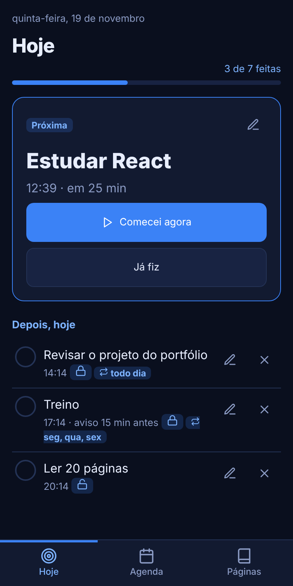
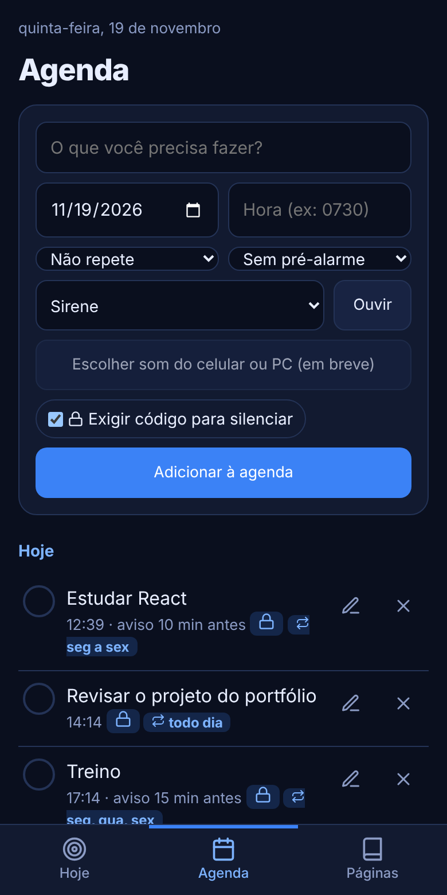
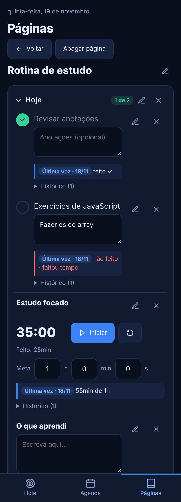
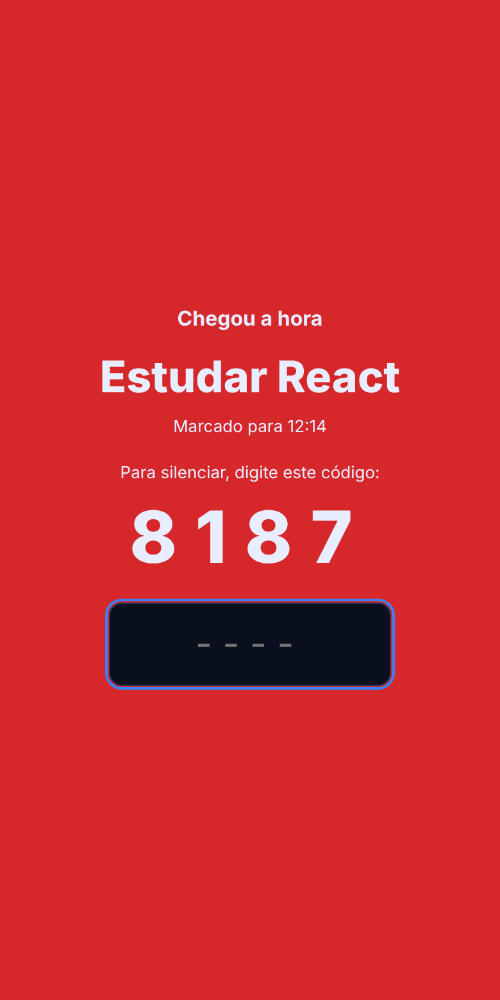

# Meu Dia Agenda

Agenda, rotina e alarmes insistentes para quem tem dificuldade de foco. Um app web em português, sem cadastro e sem servidor, que funciona no celular e no computador.

## Por que existe

O Meu Dia nasceu de uma dificuldade comum em quem tem TDAH ou procrastina: não é só esquecer a tarefa, é conseguir **começar** na hora certa. Por isso o alarme não é um aviso que se descarta sem pensar: ele insiste até você confirmar que começou.

## Capturas de tela

| Hoje (modo foco) | Agenda | Páginas | Alarme |
| --- | --- | --- | --- |
|  |  |  |  |

As capturas usam dados de exemplo.

## Funcionalidades

**Agenda e rotina**
- Tarefas com data e horário, que podem se repetir: todo dia, seg a sex, dias escolhidos ou todo mês.
- **Pré-alarme** (5 min a 1 h antes) para dar tempo de largar o que você está fazendo.
- **Alarme insistente:** som que aumenta aos poucos, tela piscando e vibração, até você agir.
- **Código de desbloqueio** opcional por tarefa (🔒): você digita um número na tela para silenciar, o que força uma pausa antes de adiar.
- Três saídas depois do código: "Comecei agora", "Me lembre em 5 minutos" e "Não vou conseguir fazer".
- Escolha entre vários sons de alarme, com prévia.

**Aba Hoje (modo foco)**
- Mostra uma tarefa por vez, a que você está fazendo ou a próxima, com a barra de progresso do dia.

**Páginas personalizáveis**
- Você cria páginas e seções do jeito que quiser: rotina, estudo, treino, projeto, lista de compras.
- Itens de três tipos: **checklist**, **texto** e **tempo** (cronômetro regressivo com meta).
- **Histórico por item:** ao tocar em "Salvar" (com a data que escolher), o app guarda o que foi feito e o que não foi, e mostra "Última vez" na próxima vez, para você ajustar a meta.
- Editar nomes, minimizar seções e confirmação antes de apagar.

**Backup**
- Exportar e importar todos os dados em um arquivo `.json`.

## Como usar

Não há instalação nem dependências. Baixe o repositório e abra o `index.html` no navegador.

Para o alarme e as notificações funcionarem direito, sirva a pasta por um endereço seguro. Localmente:

```bash
python3 -m http.server 8000
# abra http://localhost:8000
```

Depois, toque em **Ativar e testar som** na primeira tela.

## Limitações atuais

- **O alarme só toca com o app aberto.** Com a tela bloqueada ou o navegador fechado, ele não dispara. Não dependa dele para algo crítico por enquanto.
- Os dados ficam só no aparelho (no navegador). Limpar os dados do navegador apaga tudo, por isso existe o backup.
- Só em português.

## Desenvolvimento

É HTML, CSS e JavaScript puros, sem frameworks, em três arquivos:

| Arquivo | Conteúdo |
| --- | --- |
| `index.html` | Estrutura da página |
| `style.css` | Tema escuro com azul |
| `app.js` | Lógica, alarmes, páginas, histórico e backup |

O projeto foi construído em conversa com o Claude, em etapas: primeiro um protótipo de agenda e checklist, depois alarmes, repetição, histórico e visual, com testes no Android do autor.

## O que falta antes de uma versão estável

- [x] Backup (exportar e importar)
- [x] Licença
- [x] Separar o código em arquivos
- [ ] Revisão de acessibilidade (contraste, rótulos de campos, leitor de tela)
- [ ] Teste em mais aparelhos Android, com a tela bloqueada e o navegador em segundo plano
- [ ] Tornar instalável (PWA, com manifesto e ícone) e publicar em um endereço público, como o GitHub Pages
- [ ] Embutir a fonte para funcionar sem internet
- [x] Capturas de tela neste README

## Melhorias futuras

- **App Android de verdade** com alarme confiável, mesmo com a tela bloqueada ou o app fechado. É a melhoria que mais muda o projeto.
- **Escolher o som do alarme** a partir do celular ou do computador (o botão já existe, mas ainda não funciona), com som diferente para o pré-alarme e uso do volume de alarme do Android.
- **Outros idiomas.**
- **Backup automático** e, mais adiante, sincronização entre aparelhos.
- **Mais tipos de item** nas páginas, conforme o uso mostrar o que falta.

Ideias e sugestões são bem-vindas: abra uma *issue*.

## Licença

[MIT](LICENSE)
